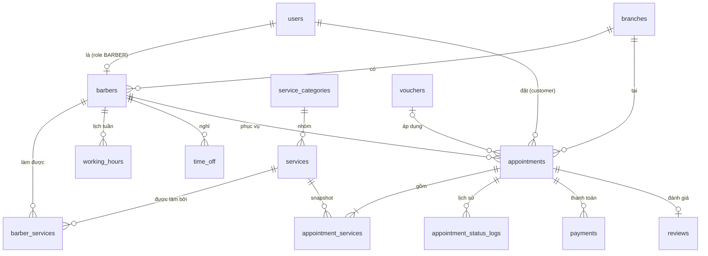
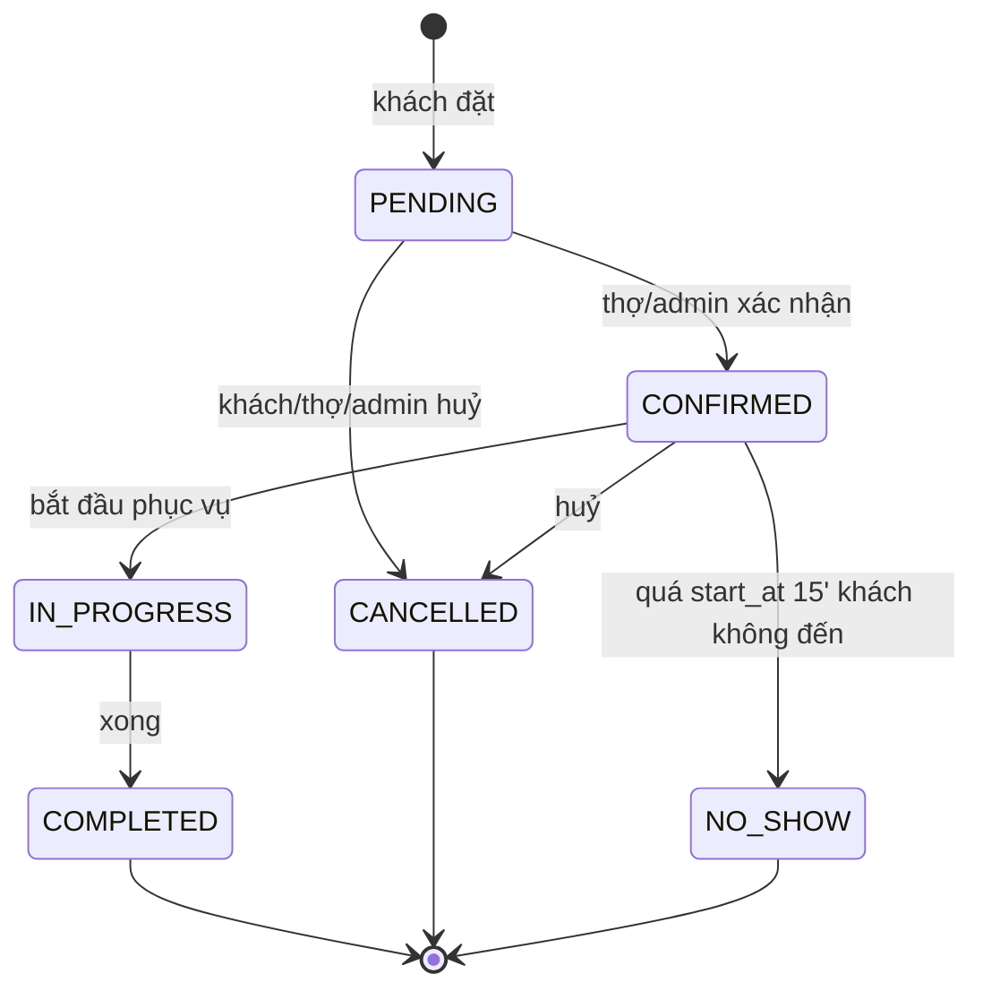

# DATABASE.md — Barber Booking

> Tài liệu này mô tả toàn bộ database của dự án đặt lịch barber. Đây là **nguồn sự thật duy nhất** (single source of truth) cho schema.
> AI/dev khi viết code backend hoặc frontend **phải tuân theo đúng tên bảng, tên cột, kiểu dữ liệu và quy tắc nghiệp vụ** ở đây. Không tự ý thêm/đổi tên cột; nếu cần thay đổi schema thì cập nhật file này + tạo migration mới.

---

## 0. Tech stack

| Tầng | Công nghệ |
|---|---|
| Database | MySQL 8.0+ (InnoDB, `utf8mb4_unicode_ci`) |
| Backend | Java 17+, Spring Boot 3, Spring Data JPA (Hibernate), Spring Security + JWT, Flyway |
| Frontend | React + TypeScript |
| Tiền tệ | VND, lưu `DECIMAL(12,0)` → Java `BigDecimal` → TS `number` |
| Thời gian | Lưu `DATETIME` theo giờ Việt Nam (`Asia/Ho_Chi_Minh`) → Java `LocalDateTime` → TS `string` dạng `"YYYY-MM-DDTHH:mm:ss"` (không có `Z`) |

---

## 1. Quy ước chung (conventions)

- Tên bảng: `snake_case`, **số nhiều** (`users`, `appointments`). Bảng nối: `a_b` (`barber_services`).
- Tên cột: `snake_case`. Java entity dùng `camelCase` + `@Column(name = "...")` khi khác tên.
- Khoá chính: `id BIGINT AUTO_INCREMENT`. Java: `Long id` với `@GeneratedValue(strategy = GenerationType.IDENTITY)`.
- Khoá ngoại: `<bảng_số_ít>_id` (`customer_id`, `barber_id`). Constraint đặt tên `fk_<bảng>_<cột>`.
- Enum: lưu bằng `ENUM(...)` MySQL, giá trị **UPPER_CASE**. Java dùng `@Enumerated(EnumType.STRING)` — **không bao giờ dùng `ORDINAL`**.
- Boolean: `BOOLEAN` (TINYINT(1)), tiền tố `is_` (`is_active`).
- Mọi bảng chính có `created_at`; bảng hay sửa có thêm `updated_at` (`ON UPDATE CURRENT_TIMESTAMP`).
- **Không xoá cứng** user / barber / service: dùng `is_active = FALSE` (soft disable) để giữ lịch sử lịch hẹn.
- `ddl-auto: validate` — schema do **Flyway** quản lý (`src/main/resources/db/migration/V1__init.sql`, `V2__...`). Hibernate không được tự tạo/sửa bảng.

---

## 2. Sơ đồ quan hệ (ERD)



---

## 3. Chi tiết các bảng

### 3.1 `users` — tài khoản

| Cột | Kiểu | Ràng buộc | Ghi chú |
|---|---|---|---|
| id | BIGINT | PK, AI | |
| full_name | VARCHAR(100) | NOT NULL | |
| phone | VARCHAR(15) | NOT NULL, UNIQUE | Dùng để đăng nhập chính, định dạng `0xxxxxxxxx` |
| email | VARCHAR(150) | NULL, UNIQUE | |
| password_hash | VARCHAR(255) | NOT NULL | BCrypt. **Không bao giờ trả về trong API** |
| role | ENUM('CUSTOMER','BARBER','ADMIN') | NOT NULL, default CUSTOMER | |
| avatar_url | VARCHAR(500) | NULL | |
| is_active | BOOLEAN | NOT NULL, default TRUE | |
| created_at, updated_at | DATETIME | | |

### 3.2 `branches` — chi nhánh

| Cột | Kiểu | Ràng buộc | Ghi chú |
|---|---|---|---|
| id | BIGINT | PK | |
| name | VARCHAR(150) | NOT NULL | |
| address | VARCHAR(255) | NOT NULL | |
| phone | VARCHAR(15) | NULL | |
| open_time / close_time | TIME | NOT NULL | Mặc định 08:00 / 21:00 |
| is_active | BOOLEAN | default TRUE | |
| created_at | DATETIME | | |

### 3.3 `barbers` — thợ (1-1 với `users` có role BARBER)

| Cột | Kiểu | Ràng buộc | Ghi chú |
|---|---|---|---|
| id | BIGINT | PK | |
| user_id | BIGINT | FK → users.id, UNIQUE | |
| branch_id | BIGINT | FK → branches.id | |
| bio | TEXT | NULL | |
| experience_years | TINYINT UNSIGNED | default 0 | |
| rating_avg | DECIMAL(3,2) | default 0.00 | Cache, cập nhật khi có review mới |
| rating_count | INT | default 0 | Cache |
| is_active | BOOLEAN | default TRUE | |
| created_at | DATETIME | | |

### 3.4 `service_categories` — nhóm dịch vụ

| Cột | Kiểu | Ghi chú |
|---|---|---|
| id | BIGINT PK | |
| name | VARCHAR(100) NOT NULL | "Cắt tóc", "Hoá chất", "Chăm sóc" |
| sort_order | INT default 0 | Thứ tự hiển thị |

### 3.5 `services` — dịch vụ

| Cột | Kiểu | Ràng buộc | Ghi chú |
|---|---|---|---|
| id | BIGINT | PK | |
| category_id | BIGINT | FK → service_categories.id, NULL | |
| name | VARCHAR(150) | NOT NULL | |
| description | TEXT | NULL | |
| price | DECIMAL(12,0) | NOT NULL, CHECK ≥ 0 | Giá gốc |
| duration_minutes | SMALLINT UNSIGNED | NOT NULL, CHECK > 0 | |
| image_url | VARCHAR(500) | NULL | |
| is_active | BOOLEAN | default TRUE | |
| created_at | DATETIME | | |

> ⚠️ Java: **không đặt tên entity là `Service`** (trùng `@Service` của Spring). Dùng `SalonService`.

### 3.6 `barber_services` — thợ làm được dịch vụ nào (N-N)

| Cột | Kiểu | Ràng buộc | Ghi chú |
|---|---|---|---|
| barber_id | BIGINT | PK, FK → barbers.id (CASCADE) | |
| service_id | BIGINT | PK, FK → services.id (CASCADE) | |
| custom_price | DECIMAL(12,0) | NULL | NULL = dùng `services.price` |

**Giá thực tế** = `COALESCE(barber_services.custom_price, services.price)`.

### 3.7 `working_hours` — lịch làm việc cố định hàng tuần

| Cột | Kiểu | Ràng buộc | Ghi chú |
|---|---|---|---|
| id | BIGINT | PK | |
| barber_id | BIGINT | FK → barbers.id | |
| day_of_week | TINYINT | CHECK 1..7 | **1 = Thứ 2 … 7 = Chủ nhật** (khớp `java.time.DayOfWeek.getValue()`; JS `Date.getDay()` thì CN = 0 → phải convert) |
| start_time / end_time | TIME | CHECK end > start | |

Một thợ có thể có **nhiều ca trong cùng 1 ngày** (vd 09:00–12:00 và 14:00–20:00). Ngày không có dòng nào = thợ nghỉ.

### 3.8 `time_off` — nghỉ phép / bận đột xuất

| Cột | Kiểu | Ràng buộc |
|---|---|---|
| id | BIGINT | PK |
| barber_id | BIGINT | FK → barbers.id |
| start_at / end_at | DATETIME | CHECK end > start |
| reason | VARCHAR(255) | NULL |

### 3.9 `appointments` — lịch hẹn (BẢNG TRUNG TÂM)

| Cột | Kiểu | Ràng buộc | Ghi chú |
|---|---|---|---|
| id | BIGINT | PK | |
| code | VARCHAR(20) | NOT NULL, UNIQUE | Mã cho khách, format `BK` + `yyyyMMdd` + 4 số. Vd `BK202611081234` |
| customer_id | BIGINT | FK → users.id | |
| barber_id | BIGINT | FK → barbers.id | |
| branch_id | BIGINT | FK → branches.id | Lấy từ `barbers.branch_id` lúc đặt |
| start_at | DATETIME | NOT NULL | |
| end_at | DATETIME | NOT NULL, CHECK > start_at | = start_at + tổng `duration_minutes`, **backend tính, không nhận từ client** |
| status | ENUM | default PENDING | Xem mục 4.2 |
| subtotal | DECIMAL(12,0) | NOT NULL | Tổng giá các dịch vụ |
| discount | DECIMAL(12,0) | default 0 | |
| total_price | DECIMAL(12,0) | NOT NULL | = subtotal − discount, ≥ 0 |
| voucher_id | BIGINT | FK → vouchers.id, NULL | |
| note | VARCHAR(500) | NULL | Ghi chú của khách |
| cancel_reason | VARCHAR(255) | NULL | |
| cancelled_at | DATETIME | NULL | |
| created_at, updated_at | DATETIME | | |
| version | INT | default 0 | `@Version` — optimistic lock khi đổi trạng thái |

Index: `(barber_id, start_at, end_at)`, `(customer_id, start_at)`, `(status)`.

### 3.10 `appointment_services` — dịch vụ trong lịch hẹn (snapshot)

| Cột | Kiểu | Ghi chú |
|---|---|---|
| appointment_id | BIGINT PK, FK (CASCADE) | |
| service_id | BIGINT PK, FK | |
| service_name | VARCHAR(150) | Snapshot tên lúc đặt |
| price | DECIMAL(12,0) | Snapshot giá lúc đặt |
| duration_minutes | SMALLINT UNSIGNED | Snapshot thời lượng |

> Giá/tên dịch vụ có thể đổi sau này, **hoá đơn cũ không được thay đổi theo** → luôn đọc từ bảng này, không join ngược `services.price`.

### 3.11 `appointment_status_logs` — lịch sử trạng thái

| Cột | Kiểu |
|---|---|
| id | BIGINT PK |
| appointment_id | FK → appointments.id |
| from_status | VARCHAR(20) NULL |
| to_status | VARCHAR(20) NOT NULL |
| changed_by | FK → users.id NULL (NULL = hệ thống tự đổi) |
| changed_at | DATETIME |

Ghi 1 dòng **mỗi lần** status thay đổi, kể cả lúc tạo (`from_status = NULL`, `to_status = PENDING`).

### 3.12 `payments` — thanh toán

| Cột | Kiểu | Ghi chú |
|---|---|---|
| id | BIGINT PK | |
| appointment_id | FK → appointments.id | 1 lịch hẹn có thể có nhiều payment (cọc + trả nốt, thất bại rồi thử lại) |
| amount | DECIMAL(12,0) | |
| method | ENUM('CASH','BANK_TRANSFER','MOMO','VNPAY','ZALOPAY','CARD') | |
| status | ENUM('PENDING','PAID','FAILED','REFUNDED') | |
| transaction_ref | VARCHAR(100) NULL | Mã giao dịch từ cổng thanh toán |
| paid_at | DATETIME NULL | |
| created_at | DATETIME | |

### 3.13 `reviews` — đánh giá

| Cột | Kiểu | Ràng buộc |
|---|---|---|
| id | BIGINT | PK |
| appointment_id | BIGINT | FK, **UNIQUE** (1 lịch hẹn – 1 review) |
| customer_id | BIGINT | FK → users.id |
| barber_id | BIGINT | FK → barbers.id |
| rating | TINYINT | CHECK 1..5 |
| comment | TEXT | NULL |
| created_at | DATETIME | |

### 3.14 `vouchers` — mã giảm giá

| Cột | Kiểu | Ghi chú |
|---|---|---|
| id | BIGINT PK | |
| code | VARCHAR(30) UNIQUE | Lưu UPPER_CASE, so sánh không phân biệt hoa thường |
| discount_type | ENUM('PERCENT','FIXED') | |
| discount_value | DECIMAL(12,0) | PERCENT: 1–100; FIXED: số tiền |
| max_discount | DECIMAL(12,0) NULL | Trần giảm cho loại PERCENT |
| min_order | DECIMAL(12,0) default 0 | Đơn tối thiểu (so với subtotal) |
| usage_limit | INT NULL | NULL = không giới hạn |
| used_count | INT default 0 | |
| valid_from / valid_to | DATETIME | |
| is_active | BOOLEAN | |

---

## 4. Quy tắc nghiệp vụ (BẮT BUỘC)

### 4.1 Đặt lịch — `POST /api/appointments`

Client chỉ gửi: `barberId`, `serviceIds[]`, `startAt`, `note?`, `voucherCode?`.
Tất cả các bước dưới đây chạy trong **một `@Transactional`**:

1. **Khoá thợ**: `SELECT * FROM barbers WHERE id = ? FOR UPDATE` (JPA: `@Lock(LockModeType.PESSIMISTIC_WRITE)`). Bắt buộc — MySQL không có exclusion constraint, đây là cách chống 2 người đặt trùng giờ.
2. Thợ phải `is_active = TRUE`.
3. Mọi `serviceIds` phải có trong `barber_services` của thợ đó và `services.is_active = TRUE`.
4. `end_at = start_at + SUM(duration_minutes)`.
5. `start_at` phải ở tương lai, tối thiểu **30 phút** sau hiện tại, tối đa **30 ngày** tới.
6. `start_at` phải là bội số của **15 phút** (09:00, 09:15, 09:30…).
7. Khoảng `[start_at, end_at)` phải **nằm gọn trong 1 ca** của `working_hours` ngày đó.
8. Không chồng với bất kỳ `time_off` nào của thợ.
9. Không chồng với appointment nào của thợ có status **không phải** `CANCELLED` / `NO_SHOW`.
10. Khách không được có lịch khác (status PENDING/CONFIRMED/IN_PROGRESS) chồng giờ.
11. Áp voucher (nếu có) → tính `discount`, tăng `vouchers.used_count`.
12. Insert `appointments` + `appointment_services` (snapshot) + `appointment_status_logs`.

**Điều kiện chồng giờ** của hai khoảng `[s1, e1)` và `[s2, e2)`:
```sql
s1 < e2 AND e1 > s2
```
(Lịch kết thúc 10:00 và lịch bắt đầu 10:00 **không** tính là trùng.)

Lỗi trả về: trùng giờ → **409 Conflict**; sai dữ liệu → **400**; không tìm thấy → **404**.

### 4.2 Vòng đời trạng thái (state machine)



- Chỉ cho phép đúng các chuyển trạng thái trên; còn lại → **400**.
- **Khách chỉ được huỷ** khi status là PENDING/CONFIRMED **và** còn ≥ 2 giờ trước `start_at`. Thợ/admin huỷ lúc nào cũng được.
- Khi huỷ: set `cancel_reason`, `cancelled_at`; nếu có voucher thì giảm `used_count` lại.
- `CANCELLED` và `NO_SHOW` **giải phóng khung giờ** (không tính khi kiểm tra trùng).

### 4.3 Tính giờ trống — `GET /api/barbers/{id}/slots?date=YYYY-MM-DD&serviceIds=1,2`

1. `duration` = tổng `duration_minutes` các dịch vụ.
2. Lấy các ca `working_hours` theo `day_of_week` của `date`.
3. Danh sách bận = appointments (trừ CANCELLED/NO_SHOW) + time_off trong ngày.
4. Duyệt mỗi ca, bước **15 phút**, slot hợp lệ khi `[t, t + duration)` nằm trong ca, không chồng khoảng bận, và `t ≥ now + 30'`.
5. Trả về mảng `"HH:mm"`.

**Không** tạo bảng slot sinh sẵn — slot luôn được tính động.

### 4.4 Voucher

Hợp lệ khi: `is_active`, `now` trong `[valid_from, valid_to]`, `used_count < usage_limit` (hoặc limit NULL), `subtotal ≥ min_order`.
- PERCENT: `discount = MIN(subtotal * value / 100, max_discount)`
- FIXED: `discount = MIN(value, subtotal)`
- Làm tròn xuống đến đơn vị đồng. `total_price` không bao giờ âm.

### 4.5 Đánh giá

- Chỉ khách sở hữu lịch hẹn được review, và chỉ khi status = `COMPLETED`.
- Sau khi insert review, cập nhật lại `barbers.rating_avg` và `rating_count` trong cùng transaction.

### 4.6 Phân quyền

| Hành động | CUSTOMER | BARBER | ADMIN |
|---|---|---|---|
| Xem dịch vụ, thợ, slot trống | ✅ | ✅ | ✅ |
| Đặt lịch | ✅ (cho chính mình) | ❌ | ✅ (đặt hộ) |
| Xem lịch hẹn | Của mình | Của mình (với tư cách thợ) | Tất cả |
| Xác nhận / bắt đầu / hoàn thành / NO_SHOW | ❌ | Lịch của mình | ✅ |
| Huỷ | Lịch của mình (luật 2 giờ) | Lịch của mình | ✅ |
| Quản lý dịch vụ, thợ, chi nhánh, voucher | ❌ | ❌ | ✅ |
| Sửa working_hours / time_off | ❌ | Của mình | ✅ |

---

## 5. Mapping kiểu dữ liệu

| MySQL | Java (entity / DTO) | TypeScript |
|---|---|---|
| BIGINT | `Long` | `number` |
| INT / SMALLINT / TINYINT | `Integer` | `number` |
| DECIMAL(12,0) | `BigDecimal` | `number` |
| DECIMAL(3,2) | `BigDecimal` | `number` |
| VARCHAR / TEXT | `String` | `string` |
| BOOLEAN | `Boolean` | `boolean` |
| DATETIME | `LocalDateTime` | `string` (`"2026-11-10T14:30:00"`) |
| TIME | `LocalTime` | `string` (`"14:30"` hoặc `"14:30:00"`) |
| DATE (query param) | `LocalDate` | `string` (`"2026-11-10"`) |
| ENUM | Java `enum` + `EnumType.STRING` | union string type |

### TypeScript types tham chiếu (frontend)

```ts
export type Role = 'CUSTOMER' | 'BARBER' | 'ADMIN';
export type AppointmentStatus =
  | 'PENDING' | 'CONFIRMED' | 'IN_PROGRESS' | 'COMPLETED' | 'CANCELLED' | 'NO_SHOW';
export type PaymentMethod = 'CASH' | 'BANK_TRANSFER' | 'MOMO' | 'VNPAY' | 'ZALOPAY' | 'CARD';
export type PaymentStatus = 'PENDING' | 'PAID' | 'FAILED' | 'REFUNDED';

export interface Service {
  id: number;
  categoryId: number | null;
  name: string;
  description: string | null;
  price: number;
  durationMinutes: number;
  imageUrl: string | null;
}

export interface Barber {
  id: number;
  fullName: string;
  avatarUrl: string | null;
  branchId: number;
  bio: string | null;
  experienceYears: number;
  ratingAvg: number;
  ratingCount: number;
}

export interface AppointmentServiceLine {
  serviceId: number;
  serviceName: string;
  price: number;
  durationMinutes: number;
}

export interface Appointment {
  id: number;
  code: string;
  customerId: number;
  barberId: number;
  barberName: string;
  branchId: number;
  startAt: string;   // "YYYY-MM-DDTHH:mm:ss" giờ VN
  endAt: string;
  status: AppointmentStatus;
  services: AppointmentServiceLine[];
  subtotal: number;
  discount: number;
  totalPrice: number;
  note: string | null;
  createdAt: string;
}

export interface CreateAppointmentRequest {
  barberId: number;
  serviceIds: number[];
  startAt: string;
  note?: string;
  voucherCode?: string;
}
```

> JSON API dùng **camelCase**. Không bao giờ trả entity JPA trực tiếp ra API — luôn map sang DTO (record).

---

## 6. DDL đầy đủ (Flyway `V1__init.sql`)

```sql
CREATE TABLE users (
  id            BIGINT AUTO_INCREMENT PRIMARY KEY,
  full_name     VARCHAR(100) NOT NULL,
  phone         VARCHAR(15)  NOT NULL,
  email         VARCHAR(150) NULL,
  password_hash VARCHAR(255) NOT NULL,
  role          ENUM('CUSTOMER','BARBER','ADMIN') NOT NULL DEFAULT 'CUSTOMER',
  avatar_url    VARCHAR(500) NULL,
  is_active     BOOLEAN NOT NULL DEFAULT TRUE,
  created_at    DATETIME NOT NULL DEFAULT CURRENT_TIMESTAMP,
  updated_at    DATETIME NOT NULL DEFAULT CURRENT_TIMESTAMP ON UPDATE CURRENT_TIMESTAMP,
  UNIQUE KEY uk_users_phone (phone),
  UNIQUE KEY uk_users_email (email)
) ENGINE=InnoDB DEFAULT CHARSET=utf8mb4 COLLATE=utf8mb4_unicode_ci;

CREATE TABLE branches (
  id          BIGINT AUTO_INCREMENT PRIMARY KEY,
  name        VARCHAR(150) NOT NULL,
  address     VARCHAR(255) NOT NULL,
  phone       VARCHAR(15)  NULL,
  open_time   TIME NOT NULL DEFAULT '08:00:00',
  close_time  TIME NOT NULL DEFAULT '21:00:00',
  is_active   BOOLEAN NOT NULL DEFAULT TRUE,
  created_at  DATETIME NOT NULL DEFAULT CURRENT_TIMESTAMP
) ENGINE=InnoDB DEFAULT CHARSET=utf8mb4 COLLATE=utf8mb4_unicode_ci;

CREATE TABLE barbers (
  id               BIGINT AUTO_INCREMENT PRIMARY KEY,
  user_id          BIGINT NOT NULL,
  branch_id        BIGINT NOT NULL,
  bio              TEXT NULL,
  experience_years TINYINT UNSIGNED NOT NULL DEFAULT 0,
  rating_avg       DECIMAL(3,2) NOT NULL DEFAULT 0.00,
  rating_count     INT NOT NULL DEFAULT 0,
  is_active        BOOLEAN NOT NULL DEFAULT TRUE,
  created_at       DATETIME NOT NULL DEFAULT CURRENT_TIMESTAMP,
  UNIQUE KEY uk_barbers_user (user_id),
  CONSTRAINT fk_barbers_user   FOREIGN KEY (user_id)   REFERENCES users(id),
  CONSTRAINT fk_barbers_branch FOREIGN KEY (branch_id) REFERENCES branches(id)
) ENGINE=InnoDB DEFAULT CHARSET=utf8mb4 COLLATE=utf8mb4_unicode_ci;

CREATE TABLE service_categories (
  id         BIGINT AUTO_INCREMENT PRIMARY KEY,
  name       VARCHAR(100) NOT NULL,
  sort_order INT NOT NULL DEFAULT 0
) ENGINE=InnoDB DEFAULT CHARSET=utf8mb4 COLLATE=utf8mb4_unicode_ci;

CREATE TABLE services (
  id               BIGINT AUTO_INCREMENT PRIMARY KEY,
  category_id      BIGINT NULL,
  name             VARCHAR(150) NOT NULL,
  description      TEXT NULL,
  price            DECIMAL(12,0) NOT NULL,
  duration_minutes SMALLINT UNSIGNED NOT NULL,
  image_url        VARCHAR(500) NULL,
  is_active        BOOLEAN NOT NULL DEFAULT TRUE,
  created_at       DATETIME NOT NULL DEFAULT CURRENT_TIMESTAMP,
  CONSTRAINT fk_services_category FOREIGN KEY (category_id) REFERENCES service_categories(id),
  CONSTRAINT chk_services_price    CHECK (price >= 0),
  CONSTRAINT chk_services_duration CHECK (duration_minutes > 0)
) ENGINE=InnoDB DEFAULT CHARSET=utf8mb4 COLLATE=utf8mb4_unicode_ci;

CREATE TABLE barber_services (
  barber_id    BIGINT NOT NULL,
  service_id   BIGINT NOT NULL,
  custom_price DECIMAL(12,0) NULL,
  PRIMARY KEY (barber_id, service_id),
  CONSTRAINT fk_bs_barber  FOREIGN KEY (barber_id)  REFERENCES barbers(id)  ON DELETE CASCADE,
  CONSTRAINT fk_bs_service FOREIGN KEY (service_id) REFERENCES services(id) ON DELETE CASCADE
) ENGINE=InnoDB DEFAULT CHARSET=utf8mb4 COLLATE=utf8mb4_unicode_ci;

CREATE TABLE working_hours (
  id          BIGINT AUTO_INCREMENT PRIMARY KEY,
  barber_id   BIGINT NOT NULL,
  day_of_week TINYINT NOT NULL,
  start_time  TIME NOT NULL,
  end_time    TIME NOT NULL,
  CONSTRAINT fk_wh_barber FOREIGN KEY (barber_id) REFERENCES barbers(id) ON DELETE CASCADE,
  CONSTRAINT chk_wh_day  CHECK (day_of_week BETWEEN 1 AND 7),
  CONSTRAINT chk_wh_time CHECK (end_time > start_time),
  KEY idx_wh_barber_day (barber_id, day_of_week)
) ENGINE=InnoDB DEFAULT CHARSET=utf8mb4 COLLATE=utf8mb4_unicode_ci;

CREATE TABLE time_off (
  id         BIGINT AUTO_INCREMENT PRIMARY KEY,
  barber_id  BIGINT NOT NULL,
  start_at   DATETIME NOT NULL,
  end_at     DATETIME NOT NULL,
  reason     VARCHAR(255) NULL,
  CONSTRAINT fk_to_barber FOREIGN KEY (barber_id) REFERENCES barbers(id) ON DELETE CASCADE,
  CONSTRAINT chk_to_time CHECK (end_at > start_at),
  KEY idx_to_barber_time (barber_id, start_at, end_at)
) ENGINE=InnoDB DEFAULT CHARSET=utf8mb4 COLLATE=utf8mb4_unicode_ci;

CREATE TABLE vouchers (
  id             BIGINT AUTO_INCREMENT PRIMARY KEY,
  code           VARCHAR(30) NOT NULL,
  discount_type  ENUM('PERCENT','FIXED') NOT NULL,
  discount_value DECIMAL(12,0) NOT NULL,
  max_discount   DECIMAL(12,0) NULL,
  min_order      DECIMAL(12,0) NOT NULL DEFAULT 0,
  usage_limit    INT NULL,
  used_count     INT NOT NULL DEFAULT 0,
  valid_from     DATETIME NOT NULL,
  valid_to       DATETIME NOT NULL,
  is_active      BOOLEAN NOT NULL DEFAULT TRUE,
  UNIQUE KEY uk_voucher_code (code)
) ENGINE=InnoDB DEFAULT CHARSET=utf8mb4 COLLATE=utf8mb4_unicode_ci;

CREATE TABLE appointments (
  id            BIGINT AUTO_INCREMENT PRIMARY KEY,
  code          VARCHAR(20) NOT NULL,
  customer_id   BIGINT NOT NULL,
  barber_id     BIGINT NOT NULL,
  branch_id     BIGINT NOT NULL,
  start_at      DATETIME NOT NULL,
  end_at        DATETIME NOT NULL,
  status        ENUM('PENDING','CONFIRMED','IN_PROGRESS','COMPLETED','CANCELLED','NO_SHOW')
                NOT NULL DEFAULT 'PENDING',
  subtotal      DECIMAL(12,0) NOT NULL,
  discount      DECIMAL(12,0) NOT NULL DEFAULT 0,
  total_price   DECIMAL(12,0) NOT NULL,
  voucher_id    BIGINT NULL,
  note          VARCHAR(500) NULL,
  cancel_reason VARCHAR(255) NULL,
  cancelled_at  DATETIME NULL,
  created_at    DATETIME NOT NULL DEFAULT CURRENT_TIMESTAMP,
  updated_at    DATETIME NOT NULL DEFAULT CURRENT_TIMESTAMP ON UPDATE CURRENT_TIMESTAMP,
  version       INT NOT NULL DEFAULT 0,
  UNIQUE KEY uk_appt_code (code),
  CONSTRAINT fk_appt_customer FOREIGN KEY (customer_id) REFERENCES users(id),
  CONSTRAINT fk_appt_barber   FOREIGN KEY (barber_id)   REFERENCES barbers(id),
  CONSTRAINT fk_appt_branch   FOREIGN KEY (branch_id)   REFERENCES branches(id),
  CONSTRAINT fk_appt_voucher  FOREIGN KEY (voucher_id)  REFERENCES vouchers(id),
  CONSTRAINT chk_appt_time    CHECK (end_at > start_at),
  CONSTRAINT chk_appt_total   CHECK (total_price >= 0),
  KEY idx_appt_barber_time   (barber_id, start_at, end_at),
  KEY idx_appt_customer_time (customer_id, start_at),
  KEY idx_appt_status        (status)
) ENGINE=InnoDB DEFAULT CHARSET=utf8mb4 COLLATE=utf8mb4_unicode_ci;

CREATE TABLE appointment_services (
  appointment_id   BIGINT NOT NULL,
  service_id       BIGINT NOT NULL,
  service_name     VARCHAR(150) NOT NULL,
  price            DECIMAL(12,0) NOT NULL,
  duration_minutes SMALLINT UNSIGNED NOT NULL,
  PRIMARY KEY (appointment_id, service_id),
  CONSTRAINT fk_as_appt    FOREIGN KEY (appointment_id) REFERENCES appointments(id) ON DELETE CASCADE,
  CONSTRAINT fk_as_service FOREIGN KEY (service_id)     REFERENCES services(id)
) ENGINE=InnoDB DEFAULT CHARSET=utf8mb4 COLLATE=utf8mb4_unicode_ci;

CREATE TABLE appointment_status_logs (
  id             BIGINT AUTO_INCREMENT PRIMARY KEY,
  appointment_id BIGINT NOT NULL,
  from_status    VARCHAR(20) NULL,
  to_status      VARCHAR(20) NOT NULL,
  changed_by     BIGINT NULL,
  changed_at     DATETIME NOT NULL DEFAULT CURRENT_TIMESTAMP,
  CONSTRAINT fk_asl_appt FOREIGN KEY (appointment_id) REFERENCES appointments(id) ON DELETE CASCADE,
  CONSTRAINT fk_asl_user FOREIGN KEY (changed_by)     REFERENCES users(id),
  KEY idx_asl_appt (appointment_id)
) ENGINE=InnoDB DEFAULT CHARSET=utf8mb4 COLLATE=utf8mb4_unicode_ci;

CREATE TABLE payments (
  id              BIGINT AUTO_INCREMENT PRIMARY KEY,
  appointment_id  BIGINT NOT NULL,
  amount          DECIMAL(12,0) NOT NULL,
  method          ENUM('CASH','BANK_TRANSFER','MOMO','VNPAY','ZALOPAY','CARD') NOT NULL,
  status          ENUM('PENDING','PAID','FAILED','REFUNDED') NOT NULL DEFAULT 'PENDING',
  transaction_ref VARCHAR(100) NULL,
  paid_at         DATETIME NULL,
  created_at      DATETIME NOT NULL DEFAULT CURRENT_TIMESTAMP,
  CONSTRAINT fk_pay_appt FOREIGN KEY (appointment_id) REFERENCES appointments(id),
  KEY idx_pay_appt (appointment_id)
) ENGINE=InnoDB DEFAULT CHARSET=utf8mb4 COLLATE=utf8mb4_unicode_ci;

CREATE TABLE reviews (
  id             BIGINT AUTO_INCREMENT PRIMARY KEY,
  appointment_id BIGINT NOT NULL,
  customer_id    BIGINT NOT NULL,
  barber_id      BIGINT NOT NULL,
  rating         TINYINT NOT NULL,
  comment        TEXT NULL,
  created_at     DATETIME NOT NULL DEFAULT CURRENT_TIMESTAMP,
  UNIQUE KEY uk_review_appt (appointment_id),
  CONSTRAINT fk_rv_appt     FOREIGN KEY (appointment_id) REFERENCES appointments(id),
  CONSTRAINT fk_rv_customer FOREIGN KEY (customer_id)    REFERENCES users(id),
  CONSTRAINT fk_rv_barber   FOREIGN KEY (barber_id)      REFERENCES barbers(id),
  CONSTRAINT chk_rv_rating  CHECK (rating BETWEEN 1 AND 5),
  KEY idx_rv_barber (barber_id)
) ENGINE=InnoDB DEFAULT CHARSET=utf8mb4 COLLATE=utf8mb4_unicode_ci;
```

---

## 7. Truy vấn mẫu hay dùng

```sql
-- Kiểm tra trùng lịch của thợ (dùng sau khi đã SELECT ... FOR UPDATE barber)
SELECT COUNT(*) FROM appointments
WHERE barber_id = :barberId
  AND status NOT IN ('CANCELLED','NO_SHOW')
  AND start_at < :endAt AND end_at > :startAt;

-- Dịch vụ thợ làm được kèm giá thực tế
SELECT s.id, s.name, s.duration_minutes,
       COALESCE(bs.custom_price, s.price) AS price
FROM barber_services bs
JOIN services s ON s.id = bs.service_id
WHERE bs.barber_id = :barberId AND s.is_active = TRUE;

-- Lịch hôm nay của 1 thợ
SELECT * FROM appointments
WHERE barber_id = :barberId
  AND start_at >= CURDATE() AND start_at < CURDATE() + INTERVAL 1 DAY
  AND status NOT IN ('CANCELLED','NO_SHOW')
ORDER BY start_at;

-- Doanh thu theo thợ trong tháng
SELECT b.id, u.full_name, COUNT(*) AS so_lich, SUM(a.total_price) AS doanh_thu
FROM appointments a
JOIN barbers b ON b.id = a.barber_id
JOIN users u   ON u.id = b.user_id
WHERE a.status = 'COMPLETED'
  AND a.start_at >= '2026-11-01' AND a.start_at < '2026-12-01'
GROUP BY b.id, u.full_name
ORDER BY doanh_thu DESC;
```

---

## 8. Cấu hình Spring liên quan

```yaml
spring:
  datasource:
    url: jdbc:mysql://localhost:3306/barber_booking?useUnicode=true&characterEncoding=utf8&serverTimezone=Asia/Ho_Chi_Minh
    username: root
    password: ${DB_PASSWORD}
  jpa:
    hibernate:
      ddl-auto: validate
    open-in-view: false
    properties:
      hibernate.jdbc.time_zone: Asia/Ho_Chi_Minh
  flyway:
    enabled: true
    locations: classpath:db/migration
  jackson:
    time-zone: Asia/Ho_Chi_Minh
    serialization:
      write-dates-as-timestamps: false
```

---

## 9. Checklist cho AI khi sinh code

- [ ] Tên bảng/cột khớp **chính xác** mục 3; enum dùng `EnumType.STRING`.
- [ ] Quan hệ `@ManyToOne` luôn `fetch = FetchType.LAZY`; tránh N+1 bằng `JOIN FETCH` hoặc `@EntityGraph`.
- [ ] Không trả entity ra controller — dùng DTO `record`.
- [ ] `end_at`, `subtotal`, `total_price`, `branch_id`, `code` do **backend tính**, không nhận từ request.
- [ ] Đặt lịch: luôn `PESSIMISTIC_WRITE` lock barber trước khi kiểm tra trùng (mục 4.1).
- [ ] Đổi trạng thái: kiểm tra state machine (4.2) + ghi `appointment_status_logs`.
- [ ] Không dùng `float`/`double` cho tiền.
- [ ] Không trả `password_hash` trong bất kỳ response nào.
- [ ] Đổi schema → tạo file Flyway mới `V{n}__mo_ta.sql` + cập nhật DATABASE.md. Không sửa migration đã chạy.
